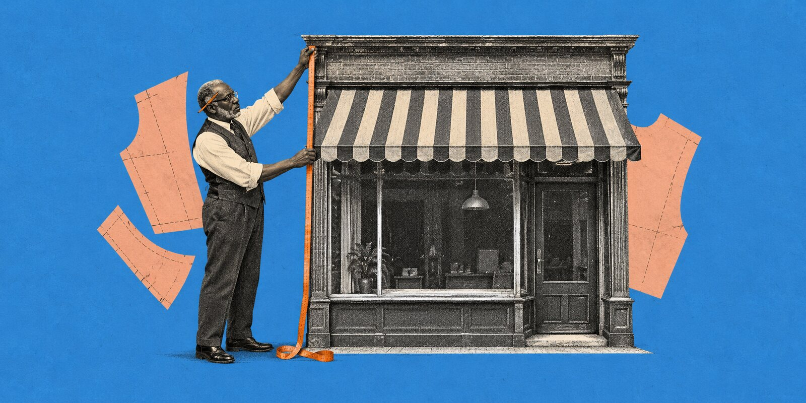
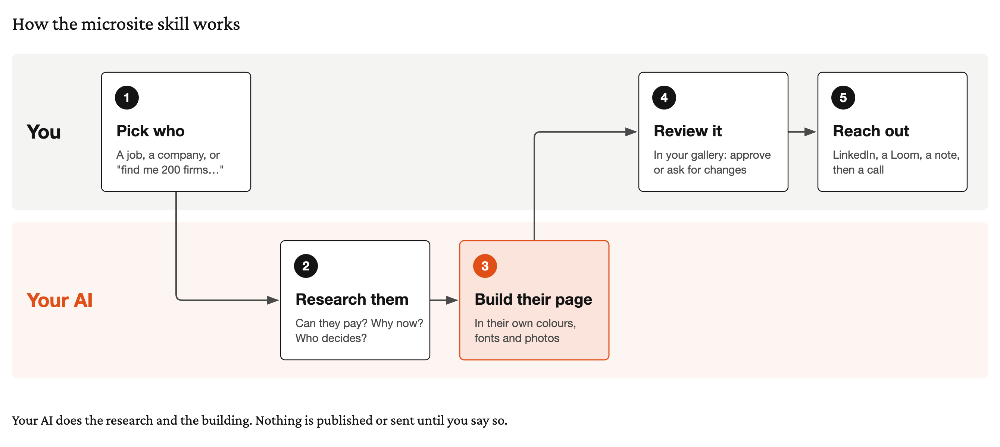
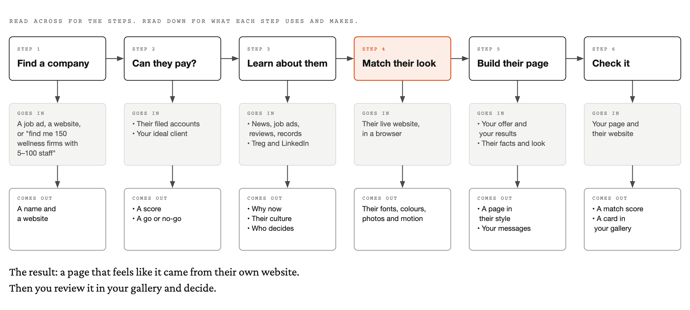
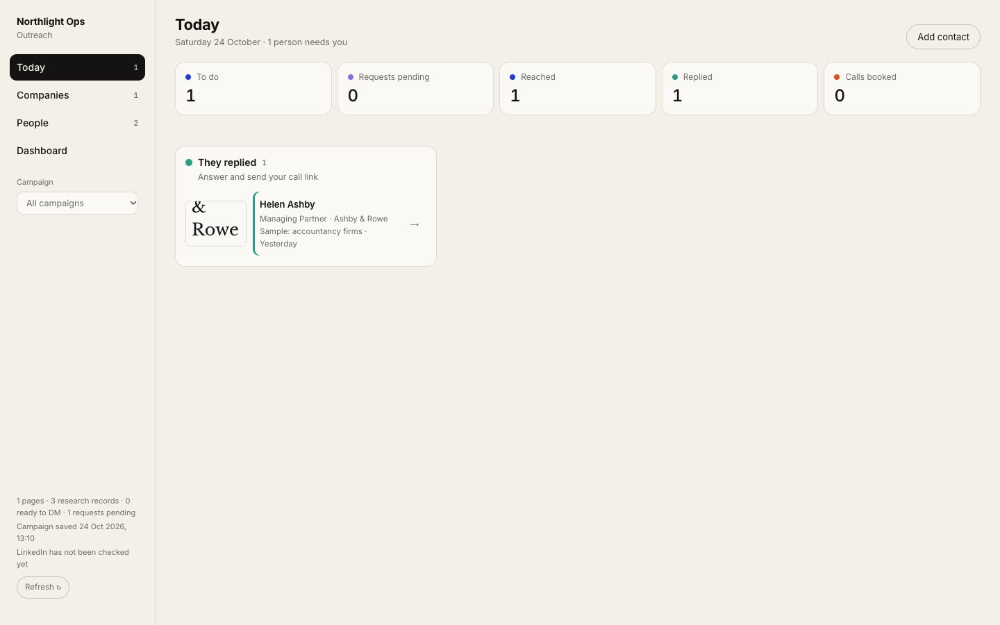
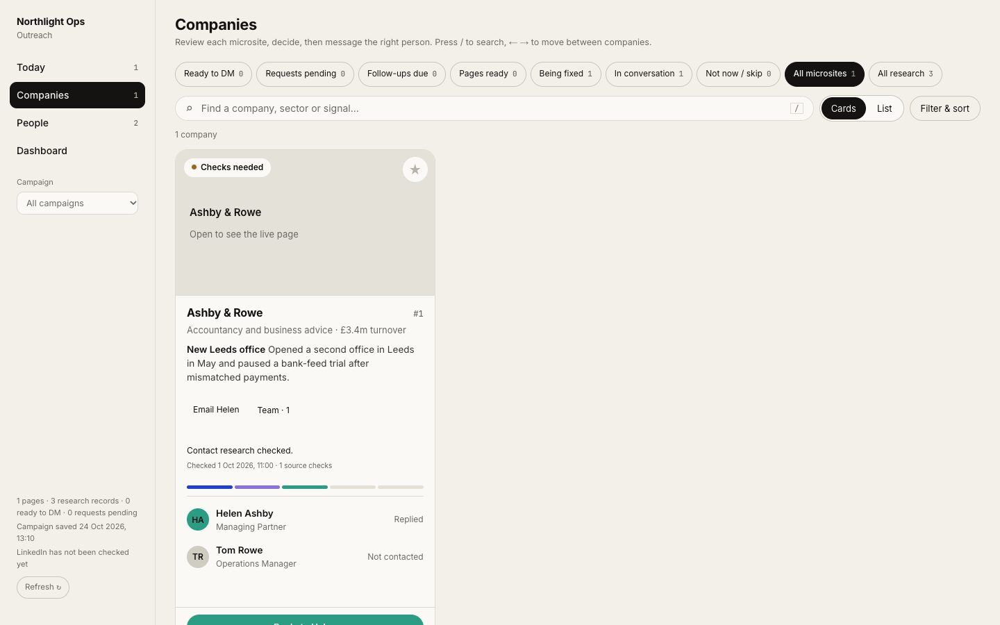
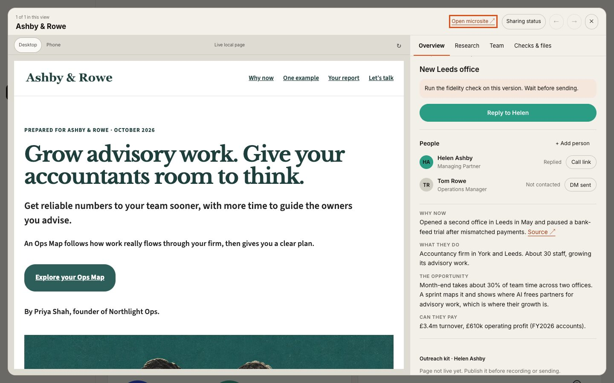
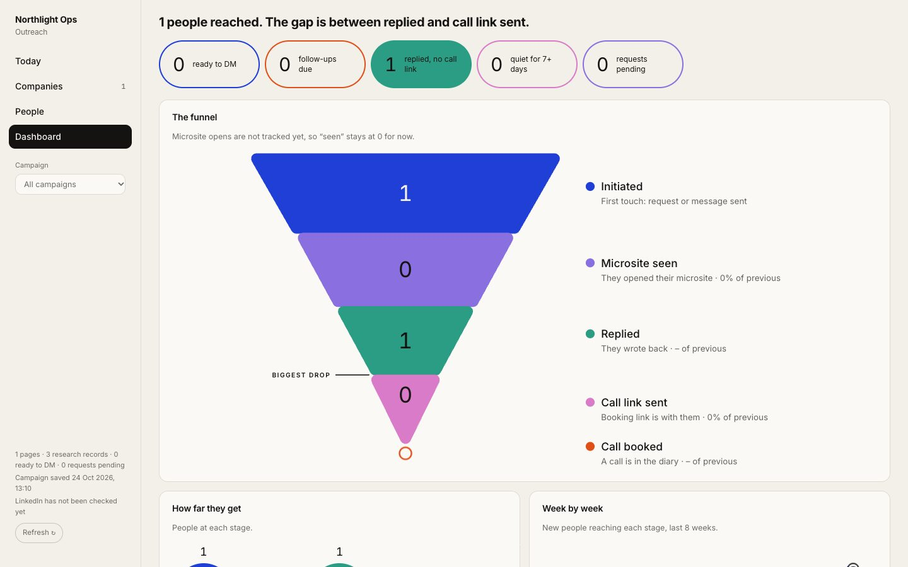
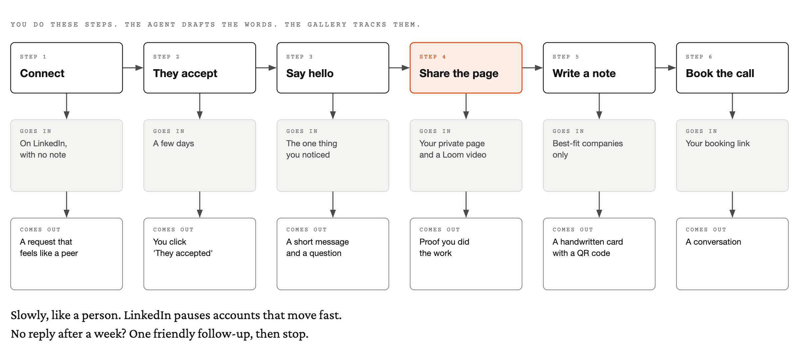
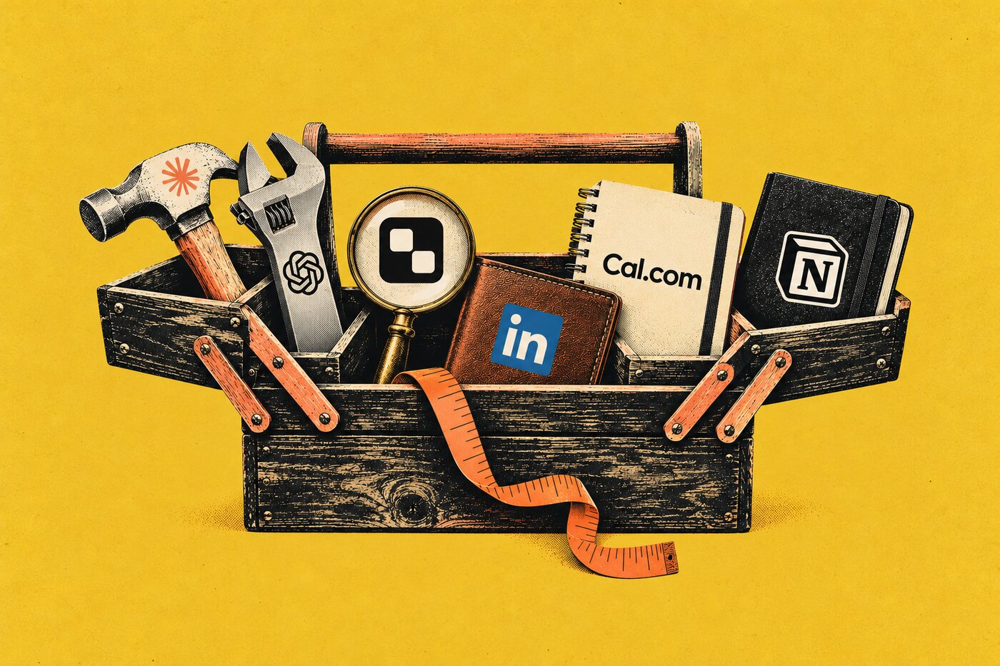

# Microsite skill

**An outbound sales team for one person.** Your AI helper finds the right companies and learns about them. Then it makes each one a private page that looks like their own website and shows how you can help. You review it, connect with the right person and book the call.

Made by [Remote Humans](https://www.remotehumans.ai/)

## Who it is for

- Consultants, agencies and freelancers who want more of the right clients
- Small teams with no sales team, or no time for research
- Anyone applying for a job or contract who wants to stand out

## The big picture



## Three ways to use it

| You say | You get |
|---|---|
| **A job:** *"Make a page for this job ad"* and the link | A page showing what you would do in your first 90 days |
| **One company:** *"Make a microsite for ashbyandrowe.co.uk"* | A check that they are a good fit, the research, and their page |
| **Many companies:** *"Find me 150 wellness companies with 5 to 100 staff and £1m to £10m in revenue"* | A ranked list of companies that can pay, and a page for each of the best |

For many companies, ask in whatever way fits how you sell. Give it a number and one or more of these:

- **Your ideal client:** *"Find me 200 companies that match our ideal client."*
- **An industry and a size:** *"Find me 150 wellness companies with 5 to 100 staff and £1m to £10m in revenue."*
- **A place:** *"Find me 500 companies in London that match my target customer."*
- **A market or a campaign:** *"Find me 100 accountancy firms in Yorkshire for our month-end campaign."*

## What you get for each company

- **A private page** in their colours, fonts and photos, with your offer, an example from their own work, and your results
- **Can they pay?** Their turnover and profit, from their filed accounts
- **Why now?** The news, hires or changes that make your offer useful today, with dates and links
- **How they think.** Their culture, so your words sound right to them
- **Who decides.** The person to contact, their LinkedIn, and a checked work email
- **Your messages.** A LinkedIn message, a Loom script, an email and a follow-up, in your voice
- **All of it in your gallery**, ready for you to review

## What happens to each company



## Your gallery

The gallery is your dashboard. It runs on your own computer and shows every company, its page, its people and how your outreach is going.

**Today** shows who needs you now: people who accepted, replied or need a follow-up.



**Companies** shows every page with the signal, the money and the people.



**Open a company** to see its page beside the research, the people and your outreach kit. Approve it here to publish it.



**Dashboard** shows how far people get, so you can see where they drop off.



## Your outreach



You send every request and message yourself. The AI writes the words, and the gallery keeps track.

Go slowly, like a person. LinkedIn pauses accounts that move too fast. The AI follows the same rule when it reads LinkedIn for you.

## What you need



- **An AI helper.** Claude or ChatGPT, in an app that can run commands, like Claude Code or Codex. It does the work.
- **Treg.** It finds and checks data about each company and its people, like work emails and phone numbers. You pay a tiny amount each time it looks something up.
- **LinkedIn**, signed in on your browser. You let your AI helper use that browser, so it can check who decides and keep your gallery up to date.
- **A booking link.** Cal.com or Calendly. People use it to book a call with you.
- **Three free tools:** Python, ImageMagick and Node.js. Your AI helper can install them with you.
- **If you like:** a notes tool, like Notion, and your own website to publish pages on.

The skill works with the AI you already use. You do not need a new platform.

## How to start

1. **Add the skill to your AI helper.** Copy it into your helper's skills folder:

   ```bash
   git clone https://github.com/remotehumans/microsite-skill.git ~/.claude/skills/microsite
   ```

   For Codex, use `~/.codex/skills/microsite` in place of `~/.claude/skills/microsite`.
2. **Ask it to set you up.** Tell your AI helper: *"Set up the microsite skill. Follow SETUP.md."*
3. **Follow along.** It shows you a checklist and works through it with you: the free tools, Treg, your browser and LinkedIn, your details, your offer, your results and the clients you want. This takes about an hour.
4. **See the sample.** It loads a made-up campaign and opens your gallery, so you can look around first.
5. **Try your first company.** Tell your AI helper: *"Make a microsite for"* and add their website. Or: *"Run a small campaign: find three companies like my ideal client in my area."*
6. **Review, approve, connect.** Look at each page in your gallery. Ask for changes. Approve the ones you like. Then follow the outreach steps.

## What it costs

- **Your AI helper:** the plan you already pay for.
- **Treg:** pay as you go. Most lookups cost a fraction of a cent, so a company usually costs cents. You set a limit for each campaign.
- **Everything else:** free. The gallery, the pages and the tools all run on your own computer.
- **Your time:** about an hour to set up. After that, you review and send.

## Why it works


A normal sales email could be for anyone, so it is easy to ignore. This page is made for one company. It looks like their website, talks about their work with real facts, and shows what you would do for them. When they open it, they can tell you did your homework.

## What it will not do

- It will not send, post or contact anyone. You do that, when you are ready.
- It will not publish a page until you click approve.
- It will not make up facts, results or numbers. Everything has a source.
- It will not guess an email address.
- It will not get round a website or LinkedIn when they block it. It stops and asks you.
- It will not choose for you. You decide who to contact and when.

## What good looks like

- The company opens the page and thinks, "this was made for us".
- The page looks and feels like part of their own website.
- Every fact is true, dated and has a source.
- They can afford what you offer.
- The offer is clear: what you do, what it costs, and how to book a call.

## Questions

**Do I need to know how to code?** No. Your AI helper runs the commands. You answer questions and review pages.

**Which AI helpers work?** Any that can read files, run commands and use a browser: Claude Code, Codex, Cursor, Gemini CLI and others.

**Is my data private?** Your research, pages and gallery stay on your computer. A page only goes online when you approve it, at a private link that search engines are told to skip.

**Will LinkedIn block me?** The AI reads lists, goes slowly and stops at the first warning. You send your own requests and messages, spread out over the day.

**Can I change where it looks for companies?** Yes. During setup you choose the sources, and you can add or switch them off later.

**What if I sell something different?** Setup asks what you sell, who it is for, what they get, what it costs and how it works, whatever form it takes. Every page is built from your answers, in your words. The samples include a web design studio and a recruitment agency.

## Try it first


The skill comes with a made-up example. Northlight Ops is a small consultancy, and Ashby & Rowe is a company it made a page for. In the skill folder, run:

```bash
python3 scripts/campaign.py demo
```

```bash
node gallery/server.mjs
```

Then open [http://127.0.0.1:4347](http://127.0.0.1:4347).

## What is inside

| Folder | What it holds |
|---|---|
| `SKILL.md` | The steps your AI helper follows |
| `SETUP.md` | How to set it up and test it, with a checklist |
| `gallery/` | Your dashboard: `node gallery/server.mjs` |
| `profiles/` | Your business, your offers, your proof and your voice. Setup fills `_template`; three fictional businesses show the range |
| `references/` | Guides for campaigns, research, design, the page, outreach and LinkedIn |
| `page/`, `sprint/`, `templates/` | The page builders: a page for any offer, a report-style discovery page, and job pages |
| `scripts/` | The tools that find, research, capture, score and publish |
| `examples/` | A sample campaign and pages for three made-up businesses: a web studio, a recruiter and a consultancy |
| `docs/` | The pictures in this guide. `python3 docs/make_diagrams.py` rebuilds the diagrams |

## Licence

Free to use and adapt for your own business, with credit to [Remote Humans](https://www.remotehumans.ai/). You may not sell the skill or a version of it. [CC BY-NC 4.0](https://creativecommons.org/licenses/by-nc/4.0/); the full text is in `LICENSE`.
